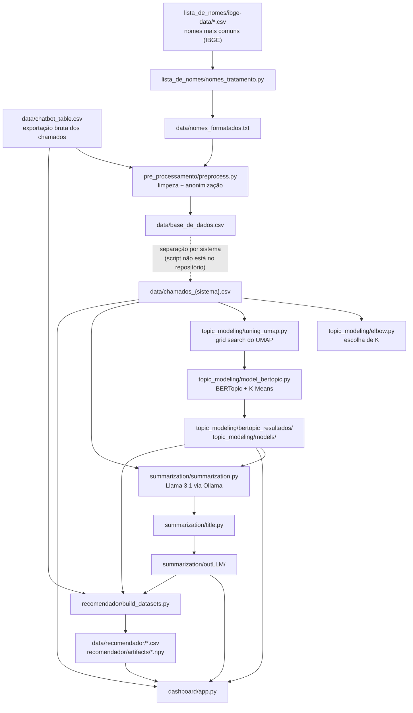

<h1 align="center">Chamados MGI — Painel de Gargalos e Recomendador de Soluções</h1>

<p align="center">
Pipeline de PLN e LLMs para analisar chamados de suporte dos sistemas de gestão de pessoas do
Ministério da Gestão e da Inovação em Serviços Públicos (MGI), identificar gargalos recorrentes
e recomendar soluções a partir do histórico de atendimentos.
</p>

---

## Sumário

1. [O que a aplicação faz](#1-o-que-a-aplicação-faz)
2. [Como funciona (pipeline)](#2-como-funciona-pipeline)
3. [Estrutura do repositório](#3-estrutura-do-repositório)
4. [Onde ficam os dados](#4-onde-ficam-os-dados)
5. [Como rodar](#5-como-rodar)
6. [Usando o painel](#6-usando-o-painel)
7. [Configurações importantes](#7-configurações-importantes)
8. [Privacidade e LGPD](#8-privacidade-e-lgpd)
9. [Limitações conhecidas](#9-limitações-conhecidas)
10. [Autores e licença](#10-autores-e-licença)

---

## 1. O que a aplicação faz

A base usada tem **40.645 chamados** abertos entre **setembro de 2023 e fevereiro de 2026**, de cinco recortes:

| Recorte | O que é | Chamados | Tópicos (K) |
|---|---|---:|---:|
| **SIAPE** | Folha de pagamento, cadastro, aposentadoria… | 23.895 | 8 |
| **SIGEPE** | Módulos do SIGEPE (frequência, consignação, benefícios…) | 6.174 | 5 |
| **SOUGOV** | App/portal SouGov.br | 4.194 | 5 |
| **SIASS** | Perícia médica, saúde do servidor | 1.244 | 6 |
| **TOTAIS** | Todos os chamados juntos (inclui e-Social, Gestão de Acesso etc.) | 40.645 | 10 |

Os chamados passam por uma esteira que entrega duas coisas aos gestores:

- **Painel de Gargalos** (Dash/Plotly): para cada sistema, mostra os temas recorrentes (tópicos), o volume de cada um, um mapa de similaridade entre tópicos, a evolução mês a mês e um diagnóstico em linguagem simples (**Título**, **Padrão Dominante** e **Impacto Operacional**) gerado por um LLM local.
- **Recomendador Inteligente** (botão flutuante no painel): o atendente descreve um problema e o sistema devolve os chamados históricos mais parecidos, junto com a última ação de acompanhamento (a solução aplicada).

## 2. Como funciona (pipeline)



| Etapa | Script | O que faz |
|---|---|---|
| 1. Lista de nomes | `lista_de_nomes/nomes_tratamento.py` | Junta os nomes masculinos e femininos mais comuns do IBGE, remove acentos e gera `data/nomes_formatados.txt`. |
| 2. Pré-processamento | `pre_processamento/preprocess.py` | Normaliza o texto (minúsculas, sem acento), remove saudações, e-mails, URLs, pontuação, números, stopwords e **nomes próprios** das colunas de texto. |
| 3. Separação por sistema | *(fora do repositório)* | Gera `data/chamados_siape.csv`, `…_siass.csv`, `…_sigepe.csv`, `…_sougov.csv` e `…_totais.csv`, filtrando pela coluna `Categoria`. |
| 4. Escolha de K | `topic_modeling/elbow.py` | Método do cotovelo (K-Means sobre embeddings reduzidos com UMAP) para sugerir o número de tópicos. |
| 5. Ajuste do UMAP | `topic_modeling/tuning_umap.py` | Grid search de `n_neighbors`, `n_components` e `metric`, escolhendo a melhor configuração pelo *silhouette score*. |
| 6. Modelagem de tópicos | `topic_modeling/model_bertopic.py` | Treina o BERTopic (embeddings `paraphrase-multilingual-MiniLM-L12-v2` + UMAP + K-Means) e salva tópicos, palavras-chave, tópico dominante de cada chamado e coordenadas 2D. |
| 7. Sumarização | `summarization/summarization.py` | Para cada tópico, envia ao Llama 3.1 (Ollama) 30 chamados do "núcleo" e 15 da "periferia" e pede o **Padrão Dominante** e o **Impacto Operacional**. |
| 8. Títulos | `summarization/title.py` | Gera um título curto (até 8 palavras) para cada tópico a partir do resumo. |
| 9. Planilha de revisão | `summarization/build_table.py` | (Opcional) Exporta uma planilha Excel com todos os tópicos para revisão por especialista. |
| 10. Base do recomendador | `recomendador/build_datasets.py` | Junta chamados + tópicos em `data/recomendador/` (roda sozinho na 1ª vez que o painel sobe). |
| 11. Painel | `dashboard/app.py` | Lê tudo acima e serve o painel em `http://127.0.0.1:8050`. |

O recomendador faz uma **busca hierárquica**: primeiro encontra os tópicos mais parecidos com a pergunta (FAISS, similaridade de cosseno), depois busca os chamados mais parecidos apenas dentro desses tópicos.

## 3. Estrutura do repositório

```
painel-chamados-mgi/
├── dashboard/                 # Painel web (Dash)
│   ├── app.py                 #   layout, callbacks e recomendador na interface
│   ├── data_loader.py         #   única camada de leitura dos resultados do pipeline
│   └── assets/style.css       #   estilo (carregado automaticamente pelo Dash)
├── recomendador/              # Busca semântica de chamados similares (usado pelo painel)
│   ├── build_datasets.py      #   gera data/recomendador/df_chamados.csv e df_topicos.csv
│   ├── retrieval_data_loader.py
│   ├── embeddings_manager.py  #   gera/carrega os embeddings (.npy)
│   ├── search_engine.py       #   índices FAISS e busca hierárquica
│   ├── recommender.py         #   regras de recomendação e filtros
│   └── main.py                #   versão de terminal (modo teste)
├── chatbot/                   # Versão antiga do recomendador (duplicada, não é usada pelo painel)
├── pre_processamento/
│   ├── preprocess.py          #   limpeza e anonimização do texto
│   └── data transf.py         #   tratamento de nulos/tempos (gera base_clean.csv, não usado adiante)
├── lista_de_nomes/
│   └── nomes_tratamento.py    #   gera a lista de nomes usada na anonimização
├── topic_modeling/
│   ├── elbow.py
│   ├── tuning_umap.py
│   └── model_bertopic.py
├── summarization/
│   ├── summarization.py
│   ├── title.py
│   └── build_table.py
├── requirements.txt
├── .env.example               # modelo das variáveis de ambiente do painel
└── LICENSE
```

## 4. Onde ficam os dados

> **Nenhum dado de chamado é versionado no Git.** A pasta `data/` e todas as saídas do pipeline estão no `.gitignore`. Quem for rodar o projeto precisa receber esses arquivos por um canal interno do MGI.

### Entradas

| Arquivo | Conteúdo | Observação |
|---|---|---|
| `data/chatbot_table.csv` | Exportação bruta: 40.645 chamados × 19 colunas (`Id`, `Título`, `Categoria`, `Organização`, `Status`, `Unidade`, `Estado`, `Data de abertura`, `Data de início de atendimento`, `Dia`, `Mês`, `Ano`, `Data de Solução`, `Tempo em horas do atendimento`, `Time`, `Descrição do chamado`, `Última ação de acompanhamento`, `Título da ultima ação padrão`, `Chamados Relacionados`) | **Texto original, pode conter dados pessoais.** |
| `lista_de_nomes/ibge-data/ibge-fem-10000.csv` e `ibge-mas-10000.csv` | 10 mil nomes femininos e 10 mil masculinos mais frequentes (IBGE) | Dado público. |

### Gerados pelo pipeline

| Caminho | Gerado por | Usado por |
|---|---|---|
| `data/nomes_formatados.txt` | `nomes_tratamento.py` | `preprocess.py` |
| `data/base_de_dados.csv` | `preprocess.py` | separação por sistema |
| `data/chamados_{siape,siass,sigepe,sougov,totais}.csv` | separação por sistema | modelagem, sumarização, painel (evolução mensal) |
| `topic_modeling/bertopic_resultados/{SISTEMA}/` | `tuning_umap.py`, `model_bertopic.py`, `elbow.py` | sumarização, painel, recomendador |
| ├─ `topicos.json` / `topicos.txt` | | palavras-chave de cada tópico |
| ├─ `Topicos_Dominantes.csv` (separador `\|`) | | probabilidade de cada chamado em cada tópico |
| ├─ `Resumo_Topicos_Dominantes.csv` | | `id` do chamado → tópico dominante |
| ├─ `topic_coordinates_2d.csv` | | posição dos tópicos no mapa do painel |
| ├─ `grid_search_resultados.csv`, `metricas_validacao.json`, `melhores_parametros_umap.json`, `parametros.json` | | registro dos experimentos |
| `topic_modeling/models/{SISTEMA}/modelo/` | `model_bertopic.py` | reuso do modelo treinado (formato safetensors) |
| `topic_modeling/bertopic_graphs/{SISTEMA}/` | `tuning_umap.py` | gráficos HTML interativos do BERTopic |
| `summarization/outLLM/detailed_summarization/{SISTEMA}/summary_topic_N.txt` | `summarization.py` | `title.py`, painel, recomendador |
| `summarization/outLLM/detailed_summarization/{SISTEMA}/titulo_topic_N.txt` | `title.py` | painel, recomendador |
| `data/recomendador/df_topicos.csv` e `df_chamados.csv` | `recomendador/build_datasets.py` | recomendador |
| `recomendador/artifacts/embeddings_{topicos,chamados}.npy` | `embeddings_manager.py` | recomendador (cache dos vetores) |

## 5. Como rodar

### 5.1 Pré-requisitos

- **Python 3.11** (é a versão usada no desenvolvimento; `pandas 3` e `numpy 2.4` exigem 3.11 ou superior).
- **Git**.
- **[Ollama](https://ollama.com/)** — só para as etapas de sumarização e títulos.
- **GPU NVIDIA (opcional)** — acelera embeddings, BERTopic e o Llama; tudo roda em CPU, só que mais devagar.
- **Espaço em disco:** cerca de 3 GB para o ambiente Python e o modelo de embeddings (baixado do Hugging Face no primeiro uso), mais ~5 GB para o Llama 3.1 se for rodar a sumarização.

### 5.2 Instalação

```bash
git clone https://github.com/LucasRivetti/painel-chamados-mgi.git
cd painel-chamados-mgi

python -m venv .venv
# Windows (PowerShell)
.venv\Scripts\Activate.ps1
# Linux/macOS
source .venv/bin/activate

pip install -r requirements.txt

# stopwords do NLTK (necessário para o pré-processamento)
python -c "import nltk; nltk.download('stopwords')"
```

> **GPU:** o `pip install` acima instala o PyTorch para CPU. Para usar GPU NVIDIA, instale antes a versão com CUDA, por exemplo:
> `pip install torch==2.5.1 --index-url https://download.pytorch.org/whl/cu121`

Depois, coloque os arquivos de dados nas pastas descritas na [seção 4](#4-onde-ficam-os-dados).

### 5.3 Subir só o painel (resultados já gerados)

É o caminho mais comum: os tópicos e resumos já foram gerados e só falta abrir o painel.

1. Copie o arquivo de exemplo de variáveis e defina usuário e senha de acesso:

   ```bash
   cp .env.example .env      # no Windows: copy .env.example .env
   ```

   ```ini
   DASHBOARD_USUARIO=mgi
   DASHBOARD_SENHA=troque-esta-senha
   ```

2. Rode o painel **de dentro da pasta `dashboard/`**:

   ```bash
   cd dashboard
   python app.py
   ```

3. Acesse **http://127.0.0.1:8050** e entre com o usuário e a senha do `.env`.

Na primeira execução o recomendador monta sua base (`data/recomendador/`) e calcula os embeddings de todos os chamados. Isso leva alguns minutos; enquanto isso o painel já funciona e o chat mostra "inicializando o motor de busca".

### 5.4 Rodar o pipeline completo

Todos os scripts usam caminhos relativos (`../data/...`), então **cada um precisa ser executado de dentro da sua própria pasta**.

```bash
# 1. Lista de nomes para anonimização
cd lista_de_nomes
python nomes_tratamento.py

# 2. Limpeza e anonimização (chatbot_table.csv -> base_de_dados.csv)
cd ../pre_processamento
python preprocess.py

# 3. Separação por sistema -> data/chamados_{sistema}.csv
#    (esse passo não está automatizado no repositório; ver "Limitações conhecidas")

# 4. Modelagem de tópicos
cd ../topic_modeling
python elbow.py            # opcional: gráficos do cotovelo para escolher K
python tuning_umap.py      # grid search do UMAP -> melhores_parametros_umap.json
python model_bertopic.py   # treina e salva o modelo e os resultados
python tuning_umap.py      # rodar de novo gera os gráficos HTML (bertopic_graphs/) com o modelo pronto

# 5. Sumarização e títulos com LLM local
ollama pull llama3.1:8b-instruct-q4_K_S
cd ../summarization
python summarization.py
python title.py
python build_table.py      # opcional: planilha Excel para revisão

# 6. Painel
cd ../dashboard
python app.py
```

Observações:

- `model_bertopic.py` **reaproveita** um modelo já salvo em `topic_modeling/models/{SISTEMA}/modelo`. Para treinar de novo, apague essa pasta.
- `summarization.py` e `title.py` **pulam** tópicos que já têm arquivo em `outLLM/`. Para gerar de novo, apague os `.txt` correspondentes.
- Se a base de chamados mudar, apague `data/recomendador/` e `recomendador/artifacts/` para o recomendador ser reconstruído.

### 5.5 Recomendador no terminal (modo teste)

```bash
cd recomendador
python build_datasets.py   # só se data/recomendador/ ainda não existir
python main.py
```

### 5.6 Disponibilizar o painel para outras pessoas

O painel roda na máquina de quem o executa. Para que gestores acessem de outro computador, há duas opções:

- **Rede interna:** rodar em um servidor do MGI e liberar a porta 8050 (em `app.py`, trocar `app.run(debug=False, port=8050)` por `app.run(host="0.0.0.0", port=8050)`).
- **Túnel temporário com Cloudflare:** com o painel rodando, instalar o [`cloudflared`](https://developers.cloudflare.com/cloudflare-one/connections/connect-networks/downloads/) e executar
  `cloudflared tunnel --url http://localhost:8050`
  O comando imprime um endereço público `https://….trycloudflare.com`, que funciona enquanto o computador e o comando estiverem ligados.

Em qualquer caso, mantenha a senha do `.env` ativa: o recomendador exibe o texto dos chamados.

## 6. Usando o painel

- **Barra lateral:** escolhe o sistema (SIASS, SIAPE, SIGEPE, SOUGOV ou TOTAIS).
- **Indicadores no topo:** número de tópicos, chamados analisados, média por tópico e o maior gargalo.
- **Mapa de tópicos:** cada círculo é um tópico; o tamanho indica o volume e a distância indica semelhança. Clique para detalhar.
- **Cartão de diagnóstico:** título, padrão dominante, impacto operacional e palavras-chave do tópico selecionado.
- **Ranking de gargalos:** tópicos ordenados por volume de chamados.
- **Evolução mensal:** chamados por mês, de todos os tópicos ou só do selecionado.
- **Tabela completa:** todos os tópicos do sistema, com ordenação.

**Recomendador Inteligente** (botão no canto inferior esquerdo). Descreva o problema em texto livre ou use os comandos:

| Comando | Efeito |
|---|---|
| `/id <número>` | Busca chamados parecidos com um chamado existente |
| `/time <nome>` | Restringe as recomendações a um time de atendimento |
| `/top <número>` | Define quantos chamados mostrar (padrão: 3) |
| `/times` | Lista os times disponíveis na base |

A busca respeita o sistema selecionado na barra lateral (em TOTAIS, busca em todos).

## 7. Configurações importantes

| O quê | Onde | Valor atual |
|---|---|---|
| Usuário e senha do painel | `.env` (`DASHBOARD_USUARIO`, `DASHBOARD_SENHA`) | definidos por quem roda |
| Número de tópicos por sistema | `K_POR_SISTEMA` em `topic_modeling/model_bertopic.py`, `summarization/summarization.py`, `summarization/title.py`, `summarization/build_table.py` e `dashboard/data_loader.py` | SIASS 6, SIAPE 8, SIGEPE 5, SOUGOV 5, TOTAIS 10 |
| Modelo de embeddings | `topic_modeling/*.py`, `recomendador/embeddings_manager.py` | `paraphrase-multilingual-MiniLM-L12-v2` |
| Modelo de linguagem | `MODEL` em `summarization/summarization.py` e `title.py` | `llama3.1:8b-instruct-q4_K_S` (Ollama) |
| Grade de busca do UMAP | `UMAP_PARAM_GRID` em `topic_modeling/tuning_umap.py` | `n_neighbors` 15/30/50, `n_components` 5/10/15, `metric` cosine/euclidean |
| Semente aleatória | `SEED` em `topic_modeling/model_bertopic.py` | 42 |
| Limiares de confiança do recomendador | `SCORE_ALTO` / `SCORE_MEDIO` em `recomendador/recommender.py` | 0,70 / 0,50 |

> Se mudar o número de tópicos de um sistema, altere `K_POR_SISTEMA` em **todos** os arquivos listados acima.

## 8. Privacidade e LGPD

- A modelagem de tópicos e a sumarização usam o texto **pré-processado**, do qual são removidos e-mails, URLs, números e nomes que constam na lista do IBGE. O prompt do LLM também instrui a trocar dados pessoais por `[DADO REMOVIDO]`.
- O LLM roda **localmente** via Ollama; nenhum texto de chamado é enviado a serviços externos.
- O **recomendador exibe o texto original** dos chamados (`chatbot_table.csv`), porque precisa mostrar a solução aplicada. Por isso o painel exige usuário e senha e não deve ser publicado aberto na internet.
- Nunca faça commit de arquivos de `data/`, de `.env` ou de saídas que contenham trechos de chamados.

## 9. Limitações conhecidas

- O script que separa `base_de_dados.csv` em `chamados_{sistema}.csv` não está no repositório.
- `model_bertopic.py` falha ao salvar as coordenadas 2D (variável `mask` não definida em `save_topic_coordinates_2d`), o que interrompe o processamento depois do primeiro sistema.
- `summarization/build_table.py` procura `teste_titulo_topic_N.txt`, mas `title.py` grava `titulo_topic_N.txt`; a coluna "Título" da planilha sai vazia.
- A pasta `chatbot/` é uma cópia antiga de `recomendador/` e pode ser removida.
- Os embeddings do recomendador ficam em cache e não são recalculados automaticamente quando a base muda (ver 5.4).

## 10. Autores e licença

Desenvolvido por **Ana Clara Dias Leal** e **Lucas Daniel Lana Maciel**, em parceria com o MGI.

Repositório original: [anacleal/chamados-MGI](https://github.com/anacleal/chamados-MGI).
Documentação e manutenção desta versão: Lucas Rivetti.

Distribuído sob a licença MIT — veja [LICENSE](LICENSE).
