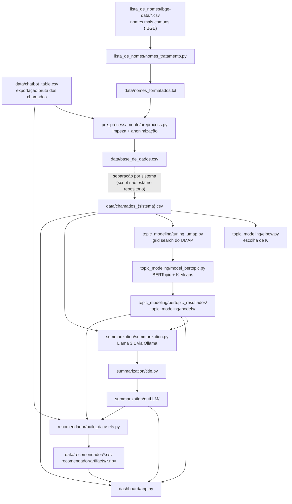

<h1 align="center">Painel de Gargalos dos Chamados do MGI</h1>

O Painel de Gargalos lê os chamados de suporte dos sistemas de gestão de pessoas do Ministério da Gestão e da Inovação em Serviços Públicos (MGI) e mostra quais problemas mais se repetem. Em vez de alguém ler milhares de chamados para entender onde as coisas travam, o painel organiza tudo em temas, mostra quanto cada um pesa e como ele evolui mês a mês.

Ele também traz um recomendador. Quem vai atender um chamado novo descreve o problema e recebe casos parecidos que já foram resolvidos, junto com a solução aplicada na época.

A base analisada hoje tem **40.645 chamados**, abertos entre setembro de 2023 e fevereiro de 2026.

---

## Sumário

1. [O problema](#1-o-problema)
2. [Como funciona, em quatro passos](#2-como-funciona-em-quatro-passos)
3. [O que o painel mostra](#3-o-que-o-painel-mostra)
4. [O recomendador de soluções](#4-o-recomendador-de-soluções)
5. [Cuidados com os dados](#5-cuidados-com-os-dados)
6. [Como rodar](#6-como-rodar)
7. [Por dentro do código](#7-por-dentro-do-código)
8. [Onde ficam os dados](#8-onde-ficam-os-dados)
9. [Configurações importantes](#9-configurações-importantes)
10. [Limitações conhecidas e próximos passos](#10-limitações-conhecidas-e-próximos-passos)
11. [Autores e licença](#11-autores-e-licença)

---

## 1. O problema

Todo dia chegam chamados sobre folha de pagamento, frequência, perícia médica, acesso a sistemas e muitos outros assuntos. Cada um é tratado individualmente, mas ninguém tem tempo de olhar o conjunto e perceber que, por exemplo, centenas de pessoas estão esbarrando no mesmo erro.

Esse é o ponto cego que o projeto ataca: transformar um volume grande de textos soltos em uma visão clara dos gargalos. Com isso, os gestores conseguem priorizar correções, orientar as equipes e acompanhar se um problema está crescendo ou diminuindo.

A análise é feita separadamente para cada sistema e também para o conjunto todo:

| Sistema | Chamados | Temas encontrados |
|---|---:|---:|
| SIAPE | 23.895 | 8 |
| SIGEPE | 6.174 | 5 |
| SOUGOV | 4.194 | 5 |
| SIASS | 1.244 | 6 |
| Todos juntos (inclui e-Social, Gestão de Acesso e outros) | 40.645 | 10 |

## 2. Como funciona, em quatro passos

1. **Limpeza e anonimização.** O texto de cada chamado passa por uma limpeza que tira nomes de pessoas, e-mails, números (como CPF e matrícula) e saudações. O que sobra é a descrição do problema.
2. **Agrupamento por assunto.** Um modelo de linguagem lê os chamados e junta os que falam da mesma coisa, mesmo quando usam palavras diferentes. O resultado são 34 temas, divididos entre os sistemas como mostra a tabela acima.
3. **Diagnóstico escrito pela IA.** Para cada tema, uma IA lê uma amostra de 45 chamados e escreve três coisas em linguagem simples: um título, o padrão que se repete e o impacto no dia a dia. Essa IA (Llama 3.1) roda no próprio computador, sem enviar nada para serviços externos.
4. **Painel.** Tudo isso vira um painel web com gráficos, protegido por senha.

Os três primeiros passos são feitos uma vez, sempre que chega uma nova leva de chamados. O painel só lê o resultado, por isso abre rápido.

Para quem quiser os detalhes técnicos de cada passo, veja [Por dentro do código](#7-por-dentro-do-código).

## 3. O que o painel mostra

Ao entrar, a pessoa escolhe um sistema na barra lateral e vê:

- **Indicadores no topo:** quantos temas foram encontrados, quantos chamados foram analisados e qual é o maior gargalo.
- **Mapa de temas:** cada círculo é um tema. O tamanho mostra o volume, e temas parecidos ficam perto um do outro.
- **Ranking:** os temas do maior para o menor.
- **Evolução mensal:** quantos chamados chegaram por mês, no geral ou de um tema específico.
- **Diagnóstico do tema:** ao clicar em um tema, aparecem o título, o padrão que se repete, o impacto e as palavras mais características.
- **Tabela completa:** todos os temas do sistema, com ordenação.

Vale um cuidado: os títulos e textos são escritos pela IA e podem trazer nomes de sistemas ou termos imprecisos. Por isso o projeto gera uma planilha (`summarization/build_table.py`) para que alguém que conheça os sistemas revise cada tema antes de qualquer decisão importante.

## 4. O recomendador de soluções

No canto da tela fica o botão **Recomendador Inteligente**. A pessoa descreve o problema com as próprias palavras, como "servidor não consegue registrar frequência no app", e o sistema procura no histórico os chamados mais parecidos.

Para cada resultado, aparecem o título do chamado, o time que atendeu, a descrição original e a última ação registrada, que normalmente é a solução aplicada. A busca entende o sentido da frase, não só as palavras exatas, e respeita o sistema escolhido no painel.

Na prática, isso ajuda quem atende a não começar do zero: se o mesmo problema já foi resolvido antes, a resposta está a um clique. Além do texto livre, o chat aceita alguns comandos:

| Comando | O que faz |
|---|---|
| `/id <número>` | Busca chamados parecidos com um chamado que já existe |
| `/time <nome>` | Mostra só recomendações de um time de atendimento |
| `/top <número>` | Define quantos chamados aparecem (padrão: 3) |
| `/times` | Lista os times que existem na base |

## 5. Cuidados com os dados

Como os chamados são escritos por servidores e falam da vida funcional de pessoas, o projeto foi pensado para expor o mínimo possível:

- **Nenhum dado de chamado está no GitHub.** O código é público, mas as bases e os resultados ficam só nos computadores da equipe. A pasta `data/` e todas as saídas do processo estão no `.gitignore`.
- **A IA roda localmente.** Nenhum texto é enviado para serviços de inteligência artificial na internet.
- **Os temas e resumos usam texto anonimizado.** A IA também foi instruída a trocar qualquer dado pessoal por "[DADO REMOVIDO]".
- **O painel exige usuário e senha**, definidos no arquivo `.env` de quem roda.

O ponto de atenção é o recomendador: para mostrar a solução, ele exibe o texto original dos chamados. Por isso o painel completo não deve ficar aberto na internet, e hospedá-lo fora da estrutura do MGI depende de autorização do ministério.

## 6. Como rodar

### 6.1 Antes de começar

- **Python 3.11.** Pode ser o instalador do [python.org](https://www.python.org/downloads/) ou o [Anaconda/Miniconda](https://www.anaconda.com/download). O 3.13 não serve: a versão do PyTorch usada no projeto não existe para ele no Windows.
- **Os dados do projeto.** Como eles não estão no GitHub, precisam ser recebidos por um canal interno e colocados nas pastas descritas em [Onde ficam os dados](#8-onde-ficam-os-dados).
- **Espaço em disco:** cerca de 3 GB para o ambiente Python e o modelo de linguagem do recomendador, que é baixado da internet no primeiro uso.
- **Só para refazer todo o processo:** o [Ollama](https://ollama.com/) e mais uns 5 GB para o Llama 3.1. Uma placa de vídeo NVIDIA ajuda bastante, mas não é obrigatória.

### 6.2 Instalação

Baixe o código:

```bash
git clone https://github.com/LucasRivetti/painel-chamados-mgi.git
cd painel-chamados-mgi
```

Crie um ambiente Python. Escolha **um** dos dois caminhos.

**Com Anaconda/Miniconda:**

```bash
conda create -n chamados-mgi python=3.11 -y
conda activate chamados-mgi
```

**Com o Python do python.org:**

```bash
python -m venv .venv
# Windows (PowerShell)
.venv\Scripts\Activate.ps1
# Linux/macOS
source .venv/bin/activate
```

Depois, instale os pacotes (leva alguns minutos):

```bash
python -m pip install --upgrade pip
python -m pip install -r requirements.txt

# só se for refazer o pré-processamento
python -c "import nltk; nltk.download('stopwords')"
```

> **Placa de vídeo NVIDIA (opcional):** para usá-la, instale o PyTorch com CUDA **antes** do `requirements.txt`:
> `pip install torch==2.5.1 --index-url https://download.pytorch.org/whl/cu121`

### 6.3 Abrir o painel

1. Copie o arquivo de exemplo e defina usuário e senha:

   ```bash
   cp .env.example .env      # no Windows: copy .env.example .env
   ```

   ```ini
   DASHBOARD_USUARIO=mgi
   DASHBOARD_SENHA=troque-esta-senha
   ```

2. Suba o painel:

   ```bash
   cd dashboard
   python app.py
   ```

3. Abra **http://127.0.0.1:8050** no navegador e entre com o usuário e a senha do `.env`. Para desligar, aperte `Ctrl+C` no terminal.

Na primeira vez, o recomendador leva um ou dois minutos para ficar pronto, porque baixa o modelo de linguagem. Enquanto isso, o resto do painel já funciona.

### 6.4 Refazer todo o processo

Só é preciso quando chegam chamados novos. Cada script deve ser executado **de dentro da sua própria pasta**, porque usam caminhos como `../data/...`.

```bash
# 1. Lista de nomes para anonimização
cd lista_de_nomes
python nomes_tratamento.py

# 2. Limpeza e anonimização (chatbot_table.csv -> base_de_dados.csv)
cd ../pre_processamento
python preprocess.py

# 3. Separação por sistema -> data/chamados_{sistema}.csv
#    (esse passo ainda não está no repositório; veja a seção 10)

# 4. Agrupamento por assunto
cd ../topic_modeling
python elbow.py            # opcional: ajuda a escolher o número de temas
python tuning_umap.py      # testa combinações e guarda a melhor
python model_bertopic.py   # treina e salva os temas
python tuning_umap.py      # rodar de novo gera os gráficos HTML com o modelo pronto

# 5. Diagnósticos escritos pela IA
ollama pull llama3.1:8b-instruct-q4_K_S
cd ../summarization
python summarization.py
python title.py
python build_table.py      # opcional: planilha para revisão

# 6. Painel
cd ../dashboard
python app.py
```

Algumas coisas para saber:

- `model_bertopic.py` **reaproveita** o modelo salvo em `topic_modeling/models/{SISTEMA}/modelo`. Para treinar de novo, apague essa pasta.
- `summarization.py` e `title.py` **pulam** os temas que já têm arquivo em `outLLM/`. Para gerar de novo, apague os `.txt` correspondentes.
- Se a base de chamados mudar, apague `data/recomendador/` e `recomendador/artifacts/` para o recomendador ser refeito.

### 6.5 Recomendador no terminal

Para testar o recomendador sem abrir o painel:

```bash
cd recomendador
python build_datasets.py   # só se data/recomendador/ ainda não existir
python main.py
```

## 7. Por dentro do código

### O caminho dos dados



### O que cada script faz

| Etapa | Script | O que faz |
|---|---|---|
| Lista de nomes | `lista_de_nomes/nomes_tratamento.py` | Junta os nomes mais comuns do IBGE, tira os acentos e gera `data/nomes_formatados.txt`. |
| Pré-processamento | `pre_processamento/preprocess.py` | Passa o texto para minúsculas e sem acento e remove saudações, e-mails, URLs, pontuação, números, palavras vazias e nomes próprios. |
| Escolha do número de temas | `topic_modeling/elbow.py` | Método do cotovelo (K-Means sobre os textos reduzidos com UMAP). |
| Ajuste fino | `topic_modeling/tuning_umap.py` | Testa combinações de parâmetros do UMAP e escolhe a melhor pelo *silhouette score*. |
| Agrupamento | `topic_modeling/model_bertopic.py` | Treina o BERTopic (modelo `paraphrase-multilingual-MiniLM-L12-v2` + UMAP + K-Means) e salva os temas, as palavras-chave, o tema de cada chamado e a posição de cada tema no mapa. |
| Diagnóstico | `summarization/summarization.py` | Para cada tema, envia ao Llama 3.1 30 chamados centrais e 15 periféricos e pede o padrão dominante e o impacto operacional. |
| Títulos | `summarization/title.py` | Cria um título curto (até 8 palavras) a partir do diagnóstico. |
| Planilha de revisão | `summarization/build_table.py` | Exporta todos os temas para Excel, com uma coluna para observações. |
| Base do recomendador | `recomendador/build_datasets.py` | Junta chamados e temas em `data/recomendador/`; roda sozinho na primeira vez que o painel sobe. |
| Painel | `dashboard/app.py` | Lê tudo e serve o painel em `http://127.0.0.1:8050`. |

O recomendador faz a busca em duas etapas: primeiro encontra os temas mais parecidos com a pergunta e depois procura os chamados mais parecidos só dentro desses temas (FAISS, similaridade de cosseno).

### Organização das pastas

```
painel-chamados-mgi/
├── dashboard/                 # Painel web (Dash)
│   ├── app.py                 #   layout, interações e chat do recomendador
│   ├── data_loader.py         #   única camada de leitura dos resultados
│   └── assets/style.css       #   estilo (carregado automaticamente pelo Dash)
├── recomendador/              # Busca de chamados parecidos (usada pelo painel)
│   ├── build_datasets.py      #   gera data/recomendador/df_chamados.csv e df_topicos.csv
│   ├── retrieval_data_loader.py
│   ├── embeddings_manager.py  #   gera e guarda os vetores (.npy)
│   ├── search_engine.py       #   índices FAISS e busca em duas etapas
│   ├── recommender.py         #   regras de recomendação e filtros
│   └── main.py                #   versão de terminal
├── chatbot/                   # Versão antiga do recomendador (não é usada pelo painel)
├── pre_processamento/
│   ├── preprocess.py          #   limpeza e anonimização do texto
│   └── data transf.py         #   tratamento de nulos e tempos (não usado adiante)
├── lista_de_nomes/
│   └── nomes_tratamento.py    #   lista de nomes usada na anonimização
├── topic_modeling/
│   ├── elbow.py
│   ├── tuning_umap.py
│   └── model_bertopic.py
├── summarization/
│   ├── summarization.py
│   ├── title.py
│   └── build_table.py
├── requirements.txt
├── .env.example               # modelo das configurações do painel
└── LICENSE
```

## 8. Onde ficam os dados

> **Nenhum dado de chamado vai para o Git.** Quem for rodar o projeto precisa receber esses arquivos por um canal interno do MGI e colocá-los nas pastas abaixo.

### O que entra

| Arquivo | Conteúdo | Observação |
|---|---|---|
| `data/chatbot_table.csv` | Exportação bruta: 40.645 chamados × 19 colunas (`Id`, `Título`, `Categoria`, `Organização`, `Status`, `Unidade`, `Estado`, `Data de abertura`, `Data de início de atendimento`, `Dia`, `Mês`, `Ano`, `Data de Solução`, `Tempo em horas do atendimento`, `Time`, `Descrição do chamado`, `Última ação de acompanhamento`, `Título da ultima ação padrão`, `Chamados Relacionados`) | **Texto original, pode conter dados pessoais.** |
| `lista_de_nomes/ibge-data/ibge-fem-10000.csv` e `ibge-mas-10000.csv` | Os 10 mil nomes femininos e os 10 mil masculinos mais frequentes (IBGE) | Dado público. |

### O que o processo gera

| Caminho | Gerado por | Usado por |
|---|---|---|
| `data/nomes_formatados.txt` | `nomes_tratamento.py` | `preprocess.py` |
| `data/base_de_dados.csv` | `preprocess.py` | separação por sistema |
| `data/chamados_{siape,siass,sigepe,sougov,totais}.csv` | separação por sistema | agrupamento, diagnóstico, painel (evolução mensal) |
| `topic_modeling/bertopic_resultados/{SISTEMA}/` | `tuning_umap.py`, `model_bertopic.py`, `elbow.py` | diagnóstico, painel, recomendador |
| ├─ `topicos.json` / `topicos.txt` | | palavras-chave de cada tema |
| ├─ `Topicos_Dominantes.csv` (separador `\|`) | | probabilidade de cada chamado em cada tema |
| ├─ `Resumo_Topicos_Dominantes.csv` | | `id` do chamado → tema |
| ├─ `topic_coordinates_2d.csv` | | posição dos temas no mapa do painel |
| ├─ `grid_search_resultados.csv`, `metricas_validacao.json`, `melhores_parametros_umap.json`, `parametros.json` | | registro dos testes |
| `topic_modeling/models/{SISTEMA}/modelo/` | `model_bertopic.py` | reuso do modelo treinado |
| `topic_modeling/bertopic_graphs/{SISTEMA}/` | `tuning_umap.py` | gráficos HTML interativos |
| `summarization/outLLM/detailed_summarization/{SISTEMA}/summary_topic_N.txt` | `summarization.py` | `title.py`, painel, recomendador |
| `summarization/outLLM/detailed_summarization/{SISTEMA}/titulo_topic_N.txt` | `title.py` | painel, recomendador |
| `data/recomendador/df_topicos.csv` e `df_chamados.csv` | `recomendador/build_datasets.py` | recomendador |
| `recomendador/artifacts/embeddings_{topicos,chamados}.npy` | `embeddings_manager.py` | recomendador (vetores guardados) |

## 9. Configurações importantes

| O quê | Onde | Valor atual |
|---|---|---|
| Usuário e senha do painel | `.env` (`DASHBOARD_USUARIO`, `DASHBOARD_SENHA`) | definidos por quem roda |
| Chave de sessão (opcional) | `.env` (`DASHBOARD_SECRET_KEY`) | gerada a cada início se ficar vazia |
| Número de temas por sistema | `K_POR_SISTEMA` em `topic_modeling/model_bertopic.py`, `summarization/summarization.py`, `summarization/title.py`, `summarization/build_table.py` e `dashboard/data_loader.py` | SIASS 6, SIAPE 8, SIGEPE 5, SOUGOV 5, TOTAIS 10 |
| Modelo que entende o texto | `topic_modeling/*.py`, `recomendador/embeddings_manager.py` | `paraphrase-multilingual-MiniLM-L12-v2` |
| IA que escreve os diagnósticos | `MODEL` em `summarization/summarization.py` e `title.py` | `llama3.1:8b-instruct-q4_K_S` (Ollama) |
| Combinações testadas no UMAP | `UMAP_PARAM_GRID` em `topic_modeling/tuning_umap.py` | `n_neighbors` 15/30/50, `n_components` 5/10/15, `metric` cosine/euclidean |
| Semente aleatória | `SEED` em `topic_modeling/model_bertopic.py` | 42 |
| Níveis de confiança do recomendador | `SCORE_ALTO` / `SCORE_MEDIO` em `recomendador/recommender.py` | 0,70 / 0,50 |

> Se mudar o número de temas de um sistema, altere `K_POR_SISTEMA` em **todos** os arquivos listados acima.

## 10. Limitações conhecidas e próximos passos

O que ainda precisa de atenção:

- O script que separa `base_de_dados.csv` em `chamados_{sistema}.csv` não está no repositório.
- A pasta `chatbot/` é uma cópia antiga de `recomendador/` e pode ser removida.
- Os vetores do recomendador ficam guardados e não são refeitos sozinhos quando a base muda (veja a seção 6.4).
- `tuning_umap.py` só gera os gráficos HTML se o modelo já existir, por isso precisa rodar duas vezes.
- O número de temas por sistema está repetido em cinco arquivos.

Melhorias planejadas:

- **Gargalo por tempo de atendimento**, e não só por volume. Um tema pequeno que demora muito para ser resolvido também é um gargalo.
- **Filtro de período**, para comparar, por exemplo, os últimos três meses com os anteriores.
- **Atualização mensal** com os chamados novos, sem precisar refazer todo o processo.
- **Arrumar a casa no código**, juntando configurações repetidas e removendo partes duplicadas para facilitar a manutenção.

## 11. Autores e licença

A aplicação foi desenvolvida por **Ana Clara Dias Leal** e **Lucas Daniel Lana Maciel**, em parceria com o MGI.

Repositório original: [anacleal/chamados-MGI](https://github.com/anacleal/chamados-MGI).
Documentação e manutenção desta versão: Lucas Rivetti.

Distribuído sob a licença MIT — veja [LICENSE](LICENSE).